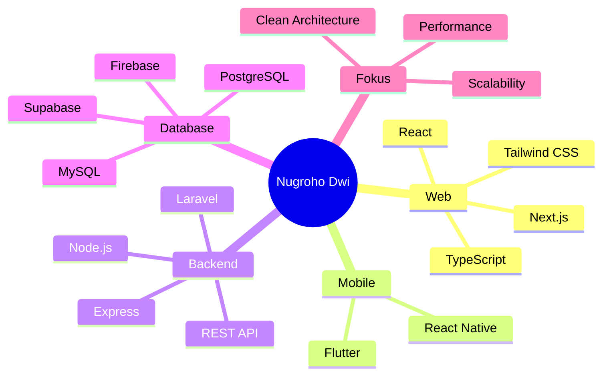

<!-- ===================== BANNER ===================== -->
<div align="center">


<a href="https://git.io/typing-svg">
  
</a>

<br/>

<p>
  
  <a href="https://github.com/NugrohoDwi0612?tab=followers">
    
  </a>
  <a href="https://github.com/NugrohoDwi0612?tab=repositories">
    
  </a>
</p>

<p>
  <a href="https://linkedin.com/in/username_anda" target="_blank">
    
  </a>
  <a href="mailto:emailanda@example.com">
    
  </a>
  <a href="https://yourportfolio.dev" target="_blank">
    
  </a>
</p>

</div>

---

## 👨‍💻 Tentang Saya

```ts
const nugroho = {
  name: "Nugroho Dwi",
  role: "Full-Stack Web & Mobile Developer",
  based: "Indonesia 🇮🇩",
  focus: ["Enterprise Web Systems", "ERP (Manufaktur, Transport)", "CMMS / Work Order", "Healthcare Systems (SIMRS)", "Point of Sale (Kasir)", "Cross-Platform Mobile Apps", "API & Database Design"],
  backend: ["Node.js / Express", "Laravel"],
  currentlyLearning: ["Cloud Architecture", "Microservices", "Mobile Performance"],
  mindset: "Ship fast, measure everything, optimize relentlessly",
  funFact: "Saya menghabiskan waktu untuk optimasi build & query sebanyak waktu menulis fitur ⚡",
};
```

Saya seorang **Full-Stack Web & Mobile Developer** yang berfokus membangun solusi digital yang **performan, scalable, dan intuitif**. Saya menjembatani arsitektur backend yang kokoh dengan antarmuka web yang responsif dan aplikasi mobile lintas platform yang mulus.

| | |
|---|---|
| 🔭 **Sedang dikerjakan** | Sistem web enterprise & aplikasi mobile cross-platform |
| 🌱 **Sedang dieksplorasi** | Cloud architecture, microservices, optimasi performa mobile |
| 💬 **Tanya saya tentang** | React / Next.js, Laravel, Flutter / React Native, RESTful API, arsitektur database, ERP, CMMS, SIMRS, POS |
| 🏭 **Pengalaman domain** | ERP manufaktur & transport/rental, CMMS / Work Order, SIMRS (rumah sakit), sistem kasir (POS), sistem koperasi |
| 🤝 **Terbuka untuk** | Kolaborasi, proyek freelance, open source, dan diskusi teknis |
| ⚡ **Fun fact** | Optimasi build time & query performance sama serunya dengan menulis fitur baru |

---

## 🛠️ Tech Stack & Tools

### 📱 Mobile Development
<p align="left">
  
  
  
  
</p>

### 🌐 Web & Frontend
<p align="left">
  
  
  
  
  
  
  
</p>

### ⚙️ Backend & Databases
<p align="left">
  
  
  
  
  
  
  
  
</p>

### 🧰 Tools & DevOps
<p align="left">
  
  
  
  
  
</p>

### 🧭 Sedang Dipelajari
<p align="left">
  
  
  
  
</p>

<details>
<summary><b>⚡ Lihat versi ringkas (Skill Icons)</b></summary>
<br/>

<p align="center">
  <a href="https://skillicons.dev">
    
  </a>
</p>

</details>

---

## 🧩 Keahlian Utama



---

## 🚀 Proyek Pilihan

> 💡 *Ganti nama, deskripsi, dan tautan repo di bawah ini sesuai proyek publik Anda.*

<table>
  <tr>
    <td width="50%" valign="top">

### 💰 Dompetku
Aplikasi **manajemen keuangan pribadi** berbasis **PWA** untuk mencatat pemasukan, pengeluaran, dan memantau kondisi finansial dengan tampilan yang ringan dan cepat.


🔗 [Lihat Repo](https://github.com/NugrohoDwi0612/dompetku)

   </td>
   <td width="50%" valign="top">

### 🚚 ERP Transport & Rental
Sistem **ERP berbasis web** untuk operasional perusahaan transport dan rental: pengelolaan armada, pemesanan, hingga pelaporan dalam satu platform terintegrasi.


🔗 *Private / Enterprise project*

   </td>
  </tr>
  <tr>
    <td width="50%" valign="top">

### 🗳️ Portal RAT Koperasi
Portal **Rapat Anggota Tahunan** untuk koperasi dengan autentikasi anggota dan UI **responsif & modern**, dibangun dengan Next.js, PrimeReact, dan next-auth.


🔗 *Private / Client project*

   </td>
   <td width="50%" valign="top">

### 🏥 SIMRS (Sistem Informasi Manajemen Rumah Sakit)
Pengembangan **sistem informasi rumah sakit** yang mencakup alur layanan, pengelolaan data, dan pelaporan operasional dengan backend **Laravel**.


🔗 *Private / Enterprise project*

   </td>
  </tr>
  <tr>
    <td width="50%" valign="top">

### 🏭 ERP Manufaktur
Sistem **ERP untuk industri manufaktur** yang mengintegrasikan perencanaan produksi, inventori, pembelian, dan pelaporan dalam satu alur kerja terpadu.


🔗 *Private / Enterprise project*

   </td>
   <td width="50%" valign="top">

### 🔧 CMMS / Work Order
Sistem **pemeliharaan aset (CMMS)** dengan manajemen **work order**: pelaporan kerusakan, penjadwalan perawatan, penugasan teknisi, dan pelacakan status.


🔗 *Private / Enterprise project*

   </td>
  </tr>
  <tr>
    <td width="50%" valign="top">

### 🧾 Sistem Kasir (POS)
Aplikasi **point of sale** untuk transaksi penjualan, manajemen produk dan stok, serta laporan harian yang cepat dan mudah dipakai kasir.


🔗 *Private / Client project*

   </td>
   <td width="50%" valign="top">

### 📂 Proyek Lainnya
Masih banyak eksperimen, template, dan proyek sampingan lain di repositori GitHub saya.


🔗 [Jelajahi Repositori](https://github.com/NugrohoDwi0612?tab=repositories)

   </td>
  </tr>
</table>

---

## 📊 Statistik GitHub

<div align="center">
  
  
</div>

<div align="center">
  
</div>

<div align="center">
  
</div>

<div align="center">
  
</div>

---

## 🐍 Kontribusi dalam Animasi

<div align="center">
  <picture>
    <source media="(prefers-color-scheme: dark)" srcset="https://raw.githubusercontent.com/NugrohoDwi0612/NugrohoDwi0612/output/github-snake-dark.svg" />
    <source media="(prefers-color-scheme: light)" srcset="https://raw.githubusercontent.com/NugrohoDwi0612/NugrohoDwi0612/output/github-snake.svg" />
    
  </picture>
</div>

> 📌 *Animasi ular membutuhkan GitHub Action [Platane/snk](https://github.com/Platane/snk). Lihat panduan singkat di bagian bawah.*

---

## 🎯 Target & Perjalanan

- [x] Membangun sistem web enterprise end-to-end
- [x] Mengembangkan aplikasi mobile cross-platform
- [x] Merancang REST API & arsitektur database yang rapi
- [ ] Menguasai arsitektur **microservices**
- [ ] Mendalami **cloud deployment** & CI/CD
- [ ] Meningkatkan **mobile performance** secara konsisten
- [ ] Berkontribusi lebih banyak ke **open source**

---

## 🧠 Prinsip Kerja

> *"Make it work, make it right, make it fast."* — Kent Beck

- ✅ **Clean & maintainable code**: kode ditulis untuk dibaca manusia
- ⚡ **Performance first**: ukur dulu, optimalkan kemudian
- 🔐 **Security by default**: validasi, autentikasi, dan otorisasi sejak awal
- 🎨 **User-centered**: UI yang indah harus tetap berguna
- 📚 **Selalu belajar**: teknologi berubah, rasa ingin tahu tidak boleh

---

## 📬 Mari Terhubung

<div align="center">

| Platform | Tautan |
|:---:|:---|
| 💼 **LinkedIn** | [linkedin.com/in/username_anda](https://linkedin.com/in/username_anda) |
| 🌐 **Portfolio** | [yourportfolio.dev](https://yourportfolio.dev) |
| 📧 **Email** | [emailanda@example.com](mailto:emailanda@example.com) |
| 🐙 **GitHub** | [@NugrohoDwi0612](https://github.com/NugrohoDwi0612) |

<br/>

**Punya ide proyek atau ingin berkolaborasi? Jangan ragu untuk menyapa!** 👋

<br/>


</div>

<!--
=====================================================
PANDUAN SETUP (hapus bagian ini setelah selesai)
=====================================================
1. Buat repo bernama sama dengan username: NugrohoDwi0612/NugrohoDwi0612 (public),
   lalu simpan file ini sebagai README.md.
2. Ganti semua placeholder: linkedin.com/in/username_anda, emailanda@example.com,
   yourportfolio.dev, dan tautan repo proyek.
3. Animasi Snake: buat file .github/workflows/snake.yml berisi:

   name: Generate Snake
   on:
     schedule: [{ cron: "0 0 * * *" }]
     workflow_dispatch:
   permissions:
     contents: write
   jobs:
     generate:
       runs-on: ubuntu-latest
       steps:
         - uses: Platane/snk/svg-only@v3
           with:
             github_user_name: ${{ github.repository_owner }}
             outputs: |
               dist/github-snake.svg
               dist/github-snake-dark.svg?palette=github-dark
         - uses: crazy-max/ghaction-github-pages@v3.1.0
           with:
             target_branch: output
             build_dir: dist
           env:
             GITHUB_TOKEN: ${{ secrets.GITHUB_TOKEN }}

   Jalankan workflow sekali secara manual (Actions > Generate Snake > Run workflow).
4. Jika kartu github-readme-stats gagal tampil (rate limit), deploy instance
   sendiri di Vercel atau hapus parameter count_private.
=====================================================
-->
